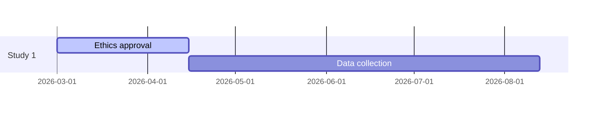

# Research Progress Tracker

Keep one small set of files that answers three questions at any time: where is the project against its deadlines, what was agreed with the supervisor, and what is the next action.

## When to use

- Setting up a plan for a thesis, paper, or funded project.
- Before a supervisor or committee meeting (agenda) and after it (minutes and actions).
- A weekly or monthly review, or a formal progress report.
- The user feels stuck or behind and needs the next concrete step.

Hand off instead for logging experiment runs (`experiment-logger`) or planning the experiments themselves (`experiment-planner`).

## Inputs

- The project goal and hard deadlines: submission dates, funding end, committee reviews, conference deadlines.
- The current state: what is done, in progress, and not started.
- Meeting notes, however rough.
- Time actually available per week, and known absences.
- Existing tracker files, if any. Read them first.

## Workflow

1. **Set up the tracker** in a `research-tracker/` folder in the project (or use the existing one):

   ```
   research-tracker/
     PLAN.md         # goal, milestones, timeline
     ACTIONS.md      # open and done action items
     DECISIONS.md    # dated decisions with reasons
     meetings/2026-03-09-supervisor.md
     reviews/2026-W11.md
   ```

2. **Build the plan backwards from the deadline.** List the deliverables (chapters, papers, studies), then the milestones each needs, then place them on the calendar from the deadline back to today. Include the slow items people forget: ethics approval, data access, co-author and supervisor review rounds (two to four weeks each), formatting, and administrative submission steps. Add a buffer of about 20 to 30%.
3. **Make milestones checkable.** "Literature review" is a topic; "Chapter 2 draft sent to supervisor" is a milestone. Each has a date, an owner, a status, and a dependency if any.
4. **Before a meeting, prepare the agenda:**
   - Progress since last meeting, against the actions that were set.
   - Results or drafts to show, sent in advance.
   - Decisions needed from the supervisor, each phrased as a question with options and the user's recommendation.
   - Blockers and what would unblock them.
   - Plan until the next meeting.
5. **After a meeting, write the minutes** from the user's notes, the same day: date and attendees, points discussed, decisions (copied to `DECISIONS.md` with the reason), and action items with owner and due date (copied to `ACTIONS.md`). Draft a short follow-up email summarising decisions and actions, for the user to send so both sides share one record.
6. **Run the weekly review:** what was completed, what slipped and why, which milestone is at risk, and the three most important actions for the coming week. Update statuses in `PLAN.md`. If a milestone slips, move the dependent dates and say what the new end date is; do not leave an impossible plan in place.
7. **Pick the next action** when the user is stuck: the smallest concrete step on the critical path that can be done in one sitting ("write the 150-word summary of paper X", not "work on chapter 2").
8. **Write progress reports** for committees or funders from the tracker: progress against planned milestones, outputs (papers, talks, datasets), deviations with reasons, plan for the next period, and risks. Use the institution's or funder's form.
9. **Render a timeline** when asked, as a Mermaid Gantt chart generated from `PLAN.md`.

## Output format

`PLAN.md`:

```markdown
# <Project> plan
Goal: ...  Hard deadline: 2027-06-30 (thesis submission). Updated: 2026-03-09.

| # | Milestone | Due | Status | Depends on | Notes |
|---|---|---|---|---|---|
| M1 | Ethics approval received | 2026-04-15 | in progress | | submitted 2026-03-01 |
| M2 | Data collection complete | 2026-08-31 | not started | M1 | |

Status values: not started, in progress, done, at risk, blocked.
```

`ACTIONS.md`:

```markdown
| ID | Action | Owner | Due | Status | From |
|---|---|---|---|---|---|
| A14 | Send Chapter 2 draft to supervisor | me | 2026-03-20 | open | meeting 2026-03-09 |
```

Meeting file:

```markdown
# Supervisor meeting, 2026-03-09
Attendees: ...
## Agenda
## Discussion
## Decisions
- D7: Use dataset B instead of A, because ...
## Actions
- A14 (me, 2026-03-20): ...
## Next meeting
```

Gantt (Mermaid):



## Quality bar and pitfalls

- Record what was actually said and decided. Do not add decisions, feedback, or commitments that are not in the user's notes; mark unclear points "to confirm with supervisor".
- Do not mark anything done that the user has not confirmed is done.
- Be honest about slippage. A plan that shows everything on track when it is not serves nobody; show the new date and the consequence.
- Every action has an owner and a date. Actions without them do not get done.
- Do not plan at 100% capacity. Teaching, illness, reviews, and revisions take time.
- Notes may contain personal or sensitive remarks about people. Keep the tracker private to the project, and keep minutes factual.
- Keep the system small. A tracker that takes longer to maintain than it saves will be abandoned; four files are enough.
- Update existing files; do not create a new plan each session.

## Related skills

- `research-scholar-orchestrator` and `idea-to-paper-pipeline` to decide what the next stage of work is.
- `experiment-logger` for run-level records that the weekly review summarises.
- `experiment-planner` and `methodology-designer` for the content of the milestones.
- `thesis-chapter-writer` for chapter milestones.
- `grant-proposal-writer` for the work plan of a funded project, and reports against it.
- `weekly-paper-digest` to feed a reading list into the actions.
- `viva-defense-prep` when the final milestone approaches.
- `supervisor-finder` uses the tracker to log contacts and replies.
