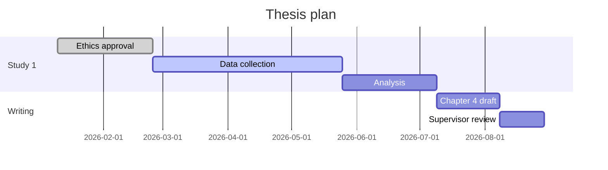

# Planning and meeting practices

## 1. Backward planning

1. Fix the hard deadline (submission, funding end, defence).
2. List deliverables (chapters, papers, datasets, software).
3. For each deliverable list milestones in order.
4. Estimate durations from past experience; add slow items explicitly.
5. Place milestones backwards from the deadline.
6. Add 20–30% buffer.
7. Check the result against today; if it starts in the past, rescope now.

## 2. Slow items people forget

| Item | Typical duration (varies widely) |
|---|---|
| Ethics approval | 3 to 12 weeks |
| Data access agreements | 1 to 6 months |
| Recruitment | Often twice the estimate |
| Supervisor review of a chapter | 2 to 4 weeks per round |
| Co-author review of a paper | 1 to 3 weeks per round |
| Journal review | 2 to 6 months per round |
| Thesis formatting and administrative submission | 2 to 4 weeks |
| Printing and binding | 1 to 2 weeks |

## 3. Milestones that can be checked

| Vague | Checkable |
|---|---|
| Work on literature review | Chapter 2 draft sent to supervisor |
| Do experiments | Main comparison complete for three datasets, logged |
| Start writing | Paper outline approved by co-authors |
| Data collection | 120 completed surveys received |

## 4. Meeting agenda

| Item | Content |
|---|---|
| Progress | Against actions from last time, with evidence |
| Results or drafts | Sent 2–3 days before the meeting |
| Decisions needed | Each as a question, with options and a recommendation |
| Blockers | What would unblock them |
| Plan | Until the next meeting |

## 5. Minutes

Write the same day. Record decisions with the reason, and actions with owner and due date. Send a short follow-up email so both sides share one record.

## 6. Weekly review questions

1. What did I complete?
2. What slipped, and why?
3. Which milestone is at risk?
4. What are the three most important actions next week?
5. Is anything blocked that someone else can unblock?

## 7. Getting unstuck

| Symptom | Smallest next action |
|---|---|
| Cannot start writing | Write the outline as bullet points for one section |
| Analysis feels huge | Run one test on one research question |
| Literature is overwhelming | Summarise one key paper in 150 words |
| Waiting on others | Send a polite reminder with a specific question |
| Lost direction | Rewrite the one-sentence aim of the project |

## 8. Progress report structure (committee or funder)

| Section | Content |
|---|---|
| Summary | Overall status in three sentences |
| Milestones | Planned versus achieved, with dates |
| Outputs | Papers, presentations, datasets, software |
| Deviations | What changed and why |
| Plan | Next period's milestones |
| Risks | With mitigation |
| Support needed | From the supervisor, department, or funder |

Use the institution's or funder's form when one exists.

## 9. Gantt chart in Mermaid

## 10. Keeping the tracker useful

Four files are enough: plan, actions, decisions, and meetings. Update them during the weekly review, not continuously. Keep them in the project folder under version control. Keep personal remarks about people out of the minutes.
